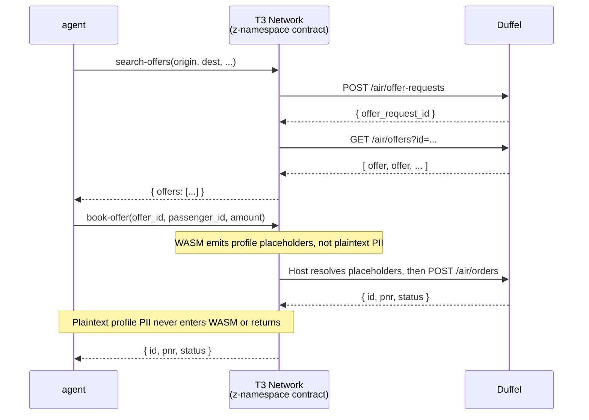

# z-tenant-flight

Duffel flight booking showcase for Trinity z-namespace tenants — v0.4.1.

A Rust WASM contract that runs inside the Trinity TEE (Trusted Execution Environment) and calls the [Duffel](https://duffel.com) API synchronously via `host:interfaces/http` and `host:interfaces/http-with-placeholders`.

## What this is

Two contract functions exposed over WIT:

| Function | What it does |
|---|---|
| `search-offers` | POST to Duffel `/air/offer-requests`, then GET `/air/offers` — returns a list of available flights |
| `book-offer` | POST to Duffel `/air/orders` with an opaque Duffel passenger ID; the host resolves profile placeholders — returns the booking ID, PNR, and status |

Privacy guarantee: passenger PII is not passed in by the agent or exposed to the contract. `book-offer` serializes `{{profile.<field>}}` markers, and the host resolves permitted profile values only when dispatching the outbound request, so plaintext profile PII never enters WASM memory. The contract returns only the booking ID, PNR, and status. Booking error bodies are logged inside the TEE and never forwarded to the caller.

## Host-capability manifest

Declare in your contract manifest:

```json
{
  "host_capabilities": [
    "kv_store",
    "logging",
    "tenant_context",
    "http",
    "http_with_placeholders"
  ]
}
```

The contract uses `http` for PII-free offer search and `http_with_placeholders` for booking, where the host resolves profile markers immediately before the Duffel request is sent.

## Setup: providing the Duffel API key

Before deploying or calling this contract for the first time, the tenant SDK must:

1. Create the `secrets` KV map in the z: namespace.
2. Write the Duffel API key under the key `duffel_api_key`.

```bash
# Example via the tenant SDK / admin tooling:
z_sdk.kv("secrets").set("duffel_api_key", "<your Duffel test API token>")
```

The contract reads this value at runtime using `host:interfaces/kv-store` — no `secret` interface is involved. The `secrets` map is owned and populated externally by the tenant operator; the contract never writes to it.

## Building

```bash
rustup target add wasm32-wasip2
cargo build --target wasm32-wasip2 --release
```

The WASM artefact will be at `target/wasm32-wasip2/release/z_tenant_flight.wasm`.

## Running tests (native)

```bash
Z_TENANT_FLIGHT_HOST_TARGET="$(rustc -vV | sed -n 's/^host: //p')"
cargo test --target "$Z_TENANT_FLIGHT_HOST_TARGET" --lib
cargo clippy --target "$Z_TENANT_FLIGHT_HOST_TARGET" --all-targets -- -D warnings
```

## Contract functions

### `search-offers`

```wit
search-offers: func(req: search-offers-req) -> result<search-offers-resp, string>;
```

Input:

```json
{
  "origin": "LHR",
  "destination": "JFK",
  "departure_date": "2026-07-15",
  "cabin_class": "economy",
  "adult_count": 1
}
```

Returns a list of `offer` records, each with `id`, `total_amount`, `total_currency`, `expires_at`, and Duffel-assigned `passenger_ids`.

### `book-offer`

```wit
book-offer: func(req: book-offer-req) -> result<booking, string>;
```

Input:

```json
{
  "offer_id": "off_abc123",
  "passenger_id": "pas_abc123",
  "total_amount": "199.00",
  "total_currency": "GBP"
}
```

`passenger_id` is the opaque Duffel-assigned value returned by `search-offers`; it is not passenger PII. Profile-backed fields are inserted as placeholders and resolved by the host through `http-with-placeholders`. The demo currently uses fixed Duffel-sandbox values for fields that are not available in the user profile schema.

Returns `{ "id": "ord_...", "pnr": "ABC123", "status": "confirmed" }`.

## Architecture


